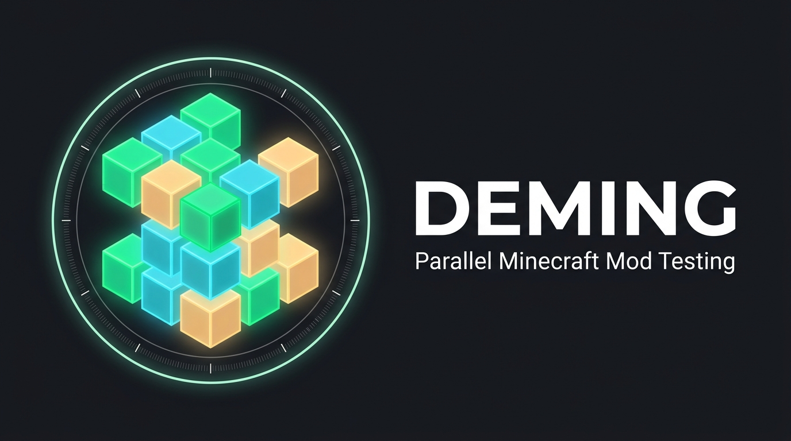

# Deming

[](LICENSE)
[]()
[]()

> **High-Throughput Parallel Minecraft Java Edition Mod Testing & Orchestration Engine**  
> *Pure Rust desktop app, JSON CLI, and Model Context Protocol (MCP) server for automated, deterministic mod testing across Vanilla, Fabric, NeoForge, Forge, and Quilt.*

---

## Overview

**Deming** is a high-performance orchestration and test-automation platform tailored specifically for Minecraft Java Edition mod developers, modpack authors, CI/CD pipelines, and AI coding agents.

Named in honor of W. Edwards Deming and the continuous improvement philosophy (PDCA), Deming transforms manual mod debugging, dependency updates, and compatibility matrices into deterministic, repeatable, and automated execution jobs. Deming lets you launch, coordinate, evaluate, and snapshot multiple Minecraft client and server instances concurrently on a single machine—all backed by strict OS-level resource isolation and failure safety.

---

## Key Features

- 🤖 **AI-First JSON CLI & Model Context Protocol (MCP) Server**  
  Built from the ground up for agentic workflows. Exposes standard stdio JSON-RPC MCP endpoints (including crash log analysis, batch mod updates, run lifecycle control, and screenshot inspection) and clean JSON CLI subcommands, enabling LLM agents to autonomously verify mod builds, inspect crashes, and capture visual proof.

- 📦 **Manifest-Driven Package Management (`deming.toml` & `deming.lock`)**  
  Declaratively define mod dependencies with `deming.toml` and pin exact mod versions, download URLs, and SHA-256 hashes via `deming.lock`. Perform Modrinth searches (`deming search`), add dependencies (`deming add`), and run syncs with dry-run verification (`deming sync --dry-run`).

- 🎒 **Modpack Ingestion (.mrpack & CurseForge)**  
  Direct support for importing Modrinth modpack archives (`.mrpack`) and CurseForge modpacks, extracting manifests, resolving required client/server dependencies, and running test matrices automatically.

- ⚡ **Multi-Loader Matrix Testing**  
  First-class support across the entire modern Minecraft Java ecosystem:
  - **Vanilla**
  - **Fabric**
  - **NeoForge**
  - **Forge**
  - **Quilt**  
  Resolves loader meta manifests, Maven library dependencies, server runtimes, and local or Modrinth mod sources seamlessly.

- 🔒 **OS-Enforced Limits & Windows Job Objects**  
  Uses native Windows Job Objects (`JOB_OBJECT_LIMIT_KILL_ON_JOB_CLOSE`) to guarantee zero orphaned `javaw.exe` instances. Fine-grained CPU core affinity, process priority controls (`Normal`, `BelowNormal`, `Idle`), RAM caps, and instant sub-millisecond **Stop / Abort All** job termination.

- 🌐 **Orchestrated Dedicated Server + Multi-Client Auto-Connect**  
  Automate complex multiplayer scenarios. Deming launches a temporary local dedicated server, waits for the world ready indicator, and spins up multiple client instances configured to automatically connect (`--quickPlayMultiplayer` or legacy parameters).

- 🔑 **Multi-Account Management**  
  Manage offline development accounts (with deterministic UUID v3 generation) for fast local iteration, side-by-side with Microsoft Authentication (MSA) via OAuth 2.0 Device-Code flow (Xbox Live, XSTS, and Minecraft session tokens) for online compatibility testing.

- 📸 **Native Window Screenshot Capture & Window Cloaking**  
  Captures native OS window buffers (`PrintWindow` / `BitBlt`) directly via HWND discovery and PID matching to generate visual artifacts of main menus, in-game states, or crash HUDs without requiring in-game mods. Optional `--cloak` mode runs instances without cluttering your desktop or taskbar while preserving full capture capabilities.

- 📊 **Crash Log Analysis & Diagnostic Tools**  
  Specialized diagnostic parsing analyzes crash reports, stack traces, and mod conflicts to pinpoint culprits and recommend remediation steps.

- 🗃️ **Structured Run Archiving & Retention**  
  Every test run is isolated into a structured directory with `manifest.json`, stdout/stderr logs, screenshots, JUnit/GameTest XML reports, and rule evaluation outcomes. Automatic retention policies handle pruning and `.zip` archiving.

- 🖥️ **Obsidian-Themed Native GUI**  
  A dark obsidian (`#181A20`) desktop application built with `eframe`/`egui` featuring an emergency abort dashboard, visual test builder, searchable log inspection, screenshot gallery, and live IPC syncing with CLI/MCP tasks.

---

## Workspace Crates Architecture

Deming is engineered as a clean, modular Rust workspace:

```
crates/
├── deming-core      # Domain models, config schemas, lockfiles, mod manifests, job specs & events
├── deming-fetch     # Mojang metadata, loader resolvers, Adoptium Java JRE manager, Modrinth client
├── deming-auth      # Microsoft Device-Code OAuth, Xbox Live/XSTS, offline UUID accounts & keystore
├── deming-runner    # Windows Job Objects, process scheduler, server/client runners, HWND capture
├── deming-archive   # Run storage, manifest serialization, log streaming, zip compression & pruning
├── deming-ipc       # Inter-process communication protocol & server for GUI/CLI/MCP live sync
├── deming-cli       # Unified CLI tool and stdio MCP server for terminal & AI agent automation
└── deming-gui       # Native desktop application (egui/eframe) with live dashboard & test builder
```

---

## Quickstart

### Prerequisites

- **Rust** 1.78+ (stable toolchain recommended)
- **Windows 10 / 11** (for native Windows Job Object isolation and HWND screen capture)
- **Git**

### Building from Source

Build the entire workspace in release mode:

```bash
cargo build --workspace --release
```

Compiled binaries will be available in `target/release/`:
- `deming.exe` (or `deming-cli.exe` / `deming-gui.exe`)

---

## Usage

### Unified Binary Entrypoint

The main binary `deming` serves as an intelligent entrypoint:
- Running `deming` without arguments launches the **GUI** desktop interface.
- Running `deming <subcommand>` (e.g. `deming run`, `deming mcp`, `deming search`) executes the **CLI / MCP** commands.

---

### 1. Launching the GUI

Start the graphical desktop application:

```bash
deming
# or directly:
cargo run -p deming-gui --release
```

The GUI connects to the local Deming IPC bus to monitor runs submitted via the CLI or MCP in real time, configure accounts, and build test suites interactively.

---

### 2. Mod & Dependency Management

Deming provides declarative mod management powered by `deming.toml` and deterministic `deming.lock` files.

#### Search for Mods
Search Modrinth for mods matching your target loader and Minecraft version:
```bash
deming search "sodium" --mc-version 1.20.4 --loader fabric
```

#### Add Mods to `deming.toml`
Add a mod by slug or project ID:
```bash
deming add sodium
```

#### Sync & Lockfile Verification
Synchronize local mod files according to `deming.toml` and update `deming.lock`:
```bash
# Preview changes without modifying files or downloading
deming sync --dry-run

# Synchronize mods
deming sync
```

---

### 3. Using the CLI for Test Runs

#### Manage Configuration
```bash
# View current global configuration
deming config get

# Set resource limits
deming config set --max-ram-mb 16384 --max-concurrent-instances 4
```

#### Manage Accounts
```bash
# List all configured accounts
deming account list

# Add an offline development account
deming account add-offline --username DevPlayer1

# Start Microsoft Device-Code login
deming account login-msa
```

#### Submit a Test Run
Submit a test specification file (`job.json`):

```bash
deming run submit job.json

# Run in cloaked mode (no visible windows, captures still functional)
deming run submit job.json --cloak
```

Example `job.json`:
```json
{
  "name": "fabric-1.20.4-smoke-test",
  "timeout_seconds": 180,
  "instances": [
    {
      "name": "client-1",
      "minecraft_version": "1.20.4",
      "mod_loader": "Fabric",
      "loader_version": null,
      "ram_mb": 4096,
      "cpu_cores": 4,
      "account": { "type": "Offline", "username": "DevTester" },
      "mods": [
        { "type": "LocalPath", "path": "./build/libs/my-mod-1.0.0.jar" }
      ],
      "completion_rule": {
        "type": "LogPattern",
        "pattern": "Done \\(.*s\\)! For help, type \"help\""
      }
    }
  ]
}
```

#### Query Run Status & Inspect Logs
```bash
# List previous test runs
deming run list

# Check status of a specific run
deming run status <RUN_ID>

# Tail logs of an instance
deming run logs <RUN_ID> client-1 --tail 100
```

---

### 4. Model Context Protocol (MCP) Server

Deming includes a built-in MCP server for integration with Claude Desktop, Cursor, Gemini, or any MCP-compatible AI agent harness:

```bash
deming mcp
```

#### Config Example (`claude_desktop_config.json`):
```json
{
  "mcpServers": {
    "deming": {
      "command": "F:\\workflow\\Deming\\target\\release\\deming.exe",
      "args": ["mcp"]
    }
  }
}
```

**Exposed MCP Tools:**
- `get_config`: Retrieve current Deming settings and resource limits.
- `set_config`: Update workspace directory, memory ceilings, or concurrency parameters.
- `list_accounts`: List stored offline and Microsoft accounts.
- `add_offline_account`: Register a new offline player username.
- `submit_test_run`: Schedule and execute a parallel test job matrix.
- `get_run_status`: Poll execution progress, instance states, and test pass/fail metrics.
- `list_runs`: Review historical test runs and archive metadata.
- `tail_instance_logs`: Fetch stdout/stderr logs from running or completed instances.
- `capture_screenshot`: Take an immediate native window capture of an active client instance.
- `abort_run`: Instantly terminate a test run and clean up all child processes.
- `analyze_crash_log`: Parse and diagnose crash reports, stack traces, and mod conflict root causes.
- `batch_update_mods`: Check and apply updates across mod dependencies against target MC/loader versions.

---

## License

This project is licensed under the [MIT License](LICENSE).
